

  

<h1 align="center">Parity</h1>

  Tee-time booking, payments and club operations for golf clubs. 
  Ukrainian first, English included.

---

Parity is the system a golf club runs on day to day. Golfers book and pay for a
tee time on the club's own website. Reception, managers and the marshal work the
same tee sheet in real time. The money is confirmed before the round is played.

It has been in daily production use at a golf club in Ukraine since 2026, with
real bookings and real card payments.

> The source code is private. This repository is a public overview of the
> product and how it is built. Screenshots show generated demo data; every
> name in them is fictional.

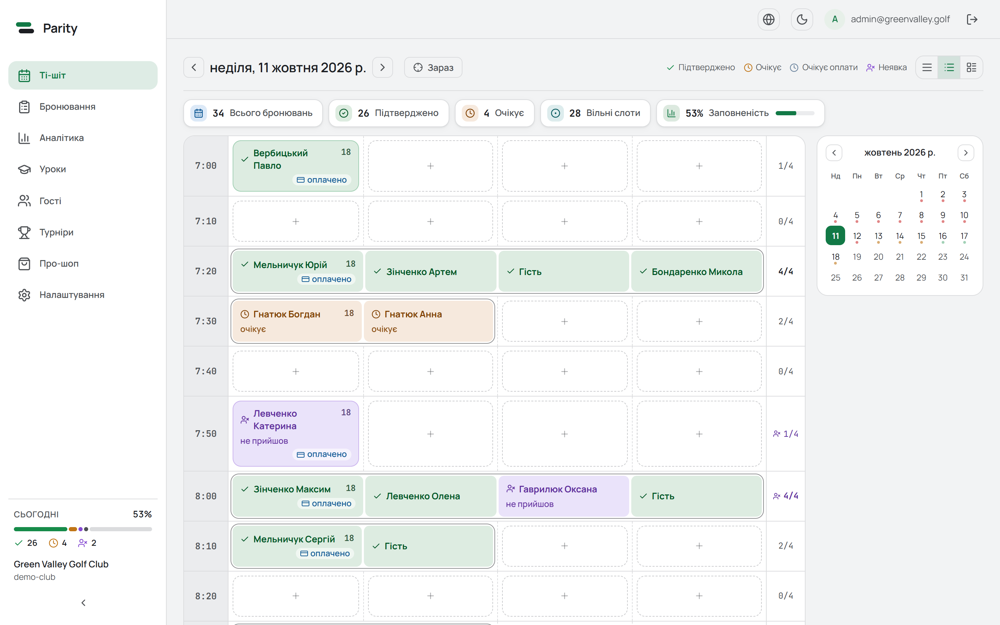

## Why it exists

Most bookings at a club used to arrive by phone and messenger and were typed
into a spreadsheet by hand. Parity moves that online without putting a
marketplace between the golfer and the club. Its goals:

- **Online is the easy way.** Booking in the widget is faster than calling the
  desk, for a regular member and for a first-time guest who scanned a QR code.
- **Paid means paid.** A booking is never shown as confirmed until the payment
  provider confirms the money. An unpaid hold says so and offers a way to pay.
- **Less load on the desk.** Fewer "is there a time?" calls and fewer bookings
  entered by hand.

## What's inside

### Booking widget

An embeddable booking flow that goes on the club's website with one
`<script>` tag, inline or as a popup.

- Date → time → contact (first visit only) → round → payment → success
- 9 or 18 holes, number of players, rental extras with prices, season-pass path
- Remembers the booker and their last round on the device, so a regular
  repeats "Sunday, 07:24, 18 holes, two players" in a few taps
- No player accounts: guest booking, with returning visitors recognised on
  their device
- Blocked times show their reason (maintenance, private event, weather,
  tournament)
- Share the tee time with playing partners via the system share sheet,
  WhatsApp, Telegram or Viber; add it to a calendar (ICS)
- Online cancellation up to the club's deadline, through a link in the
  confirmation email
- Tournament entry mode on tournament pages
- Ukrainian and English

<table>
  <tr>
    <td>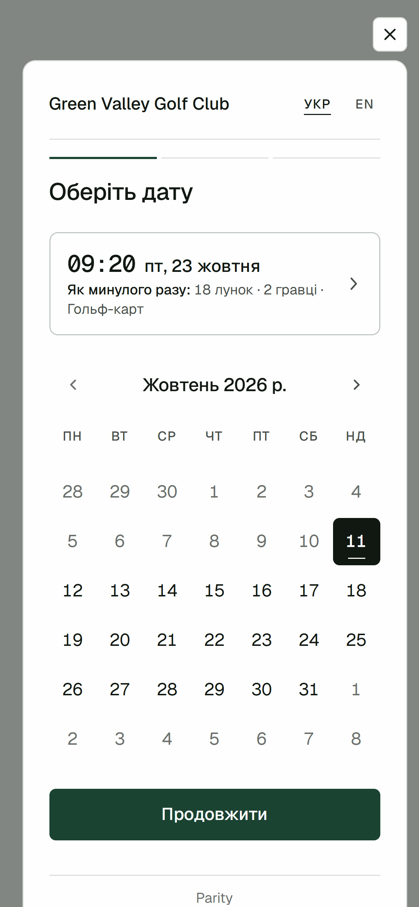</td>
    <td>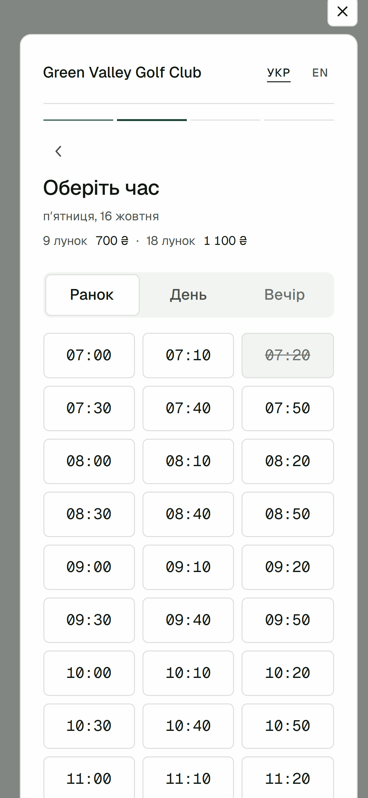</td>
    <td>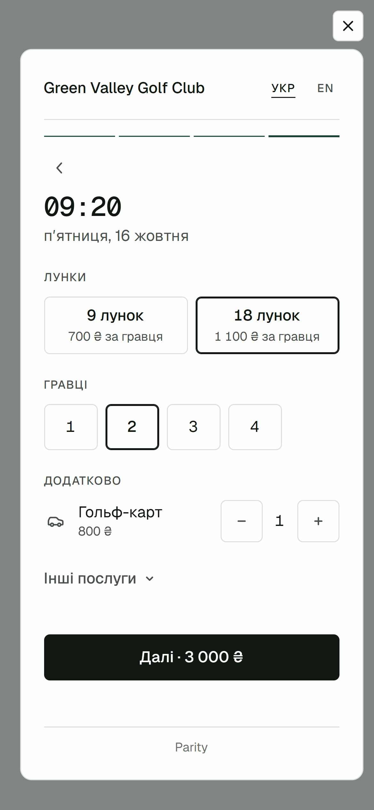</td>
    <td>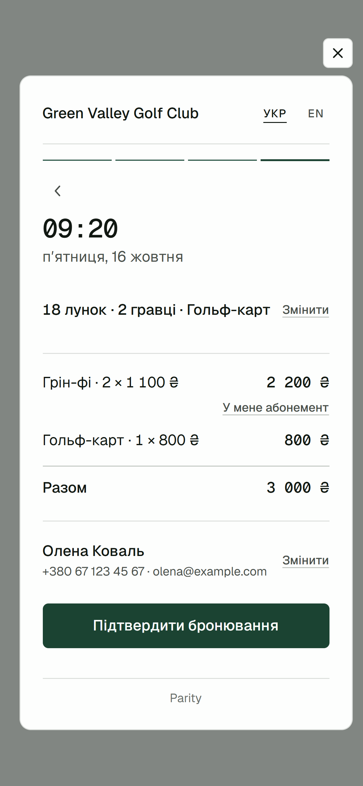</td>
    <td>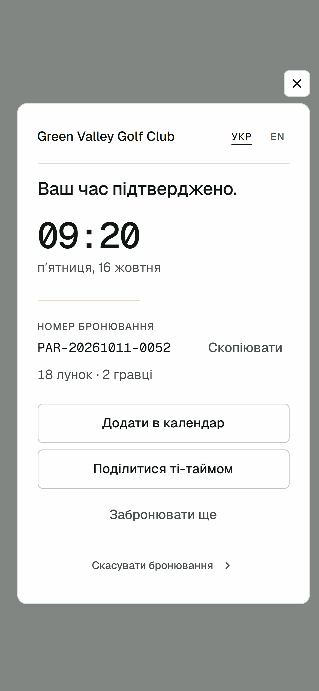</td>
  </tr>
  <tr>
    <td>Date, with «as last time» for a returning golfer</td>
    <td>Time</td>
    <td>Holes, players, extras</td>
    <td>The round and the bill</td>
    <td>Confirmed</td>
  </tr>
</table>

### Club admin

A web app for the club team, installable on a phone's home screen.

| Section | What it does |
|---|---|
| **Tee sheet** | Live grid of the day's tee times; drag-and-drop to move bookings, arrivals and no-shows, notes, full change history per booking |
| **Bookings** | Filterable list with paid totals for the day, used for daily bookkeeping |
| **Analytics** | Bookings, revenue, occupancy, cancellations and no-shows; widget funnel and traffic |
| **Lessons** | Coaching-lesson calendar, payment invoices, lesson packages, SMS notifications |
| **Guests** | Shared directory of the club's guests |
| **Tournaments** | Paid tournament entry with seat limits, multi-day events |
| **Pro shop** | Stock, barcode labels, inventory counts, XLSX import from the accounting system |
| **Settings** | Schedules and prices, booking rules, payments, team and roles, widget look, messaging |

Three roles (admin, manager, marshal) see and can do different things. The
marshal on the course gets a phone-first view of the tee sheet.

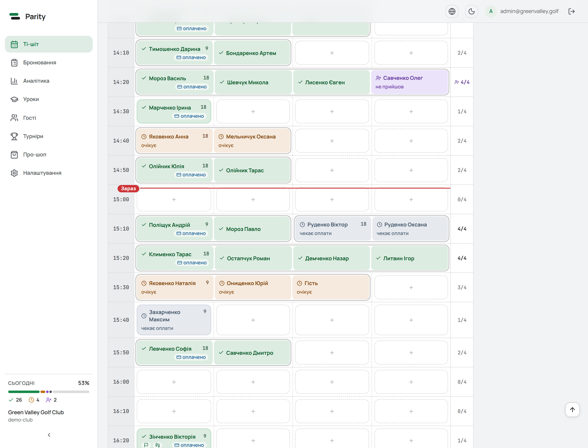

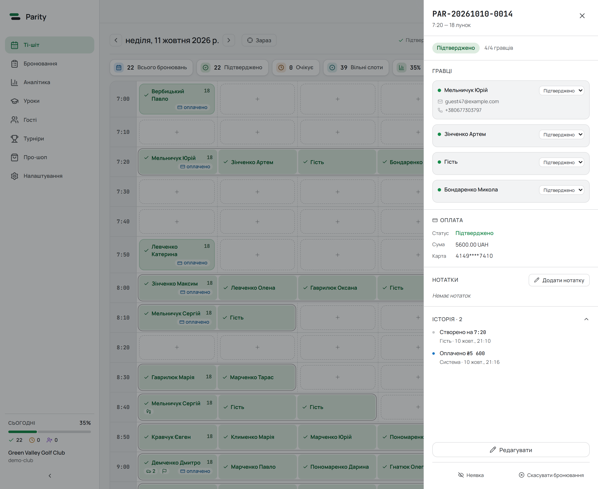

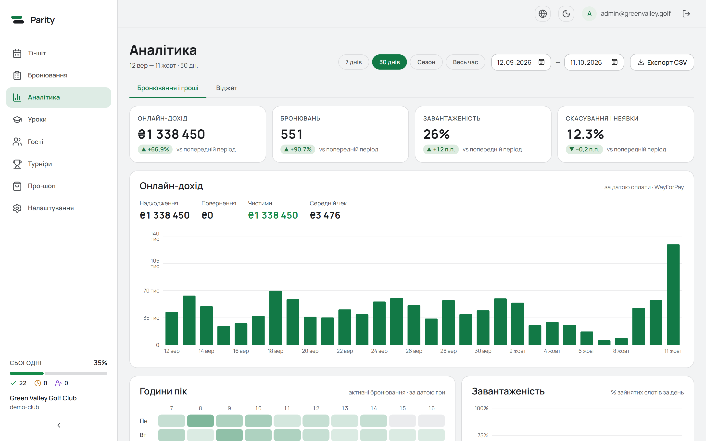

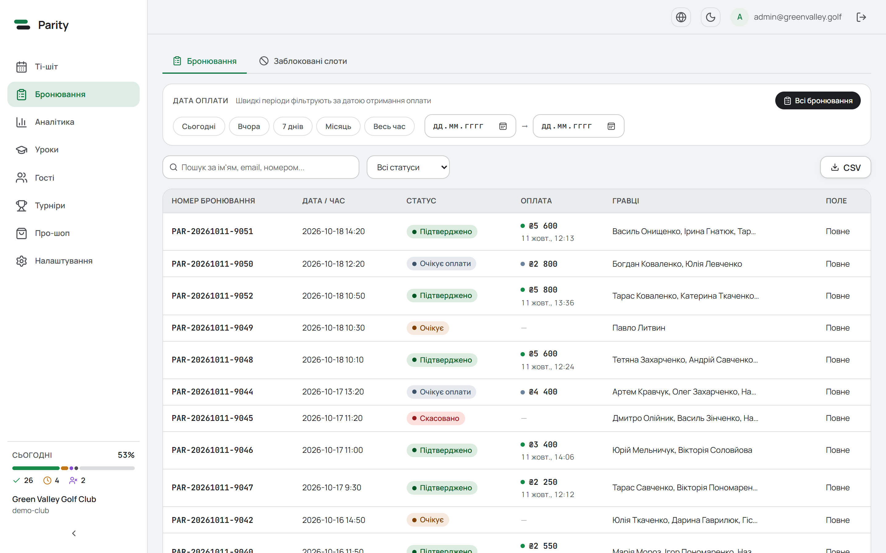

  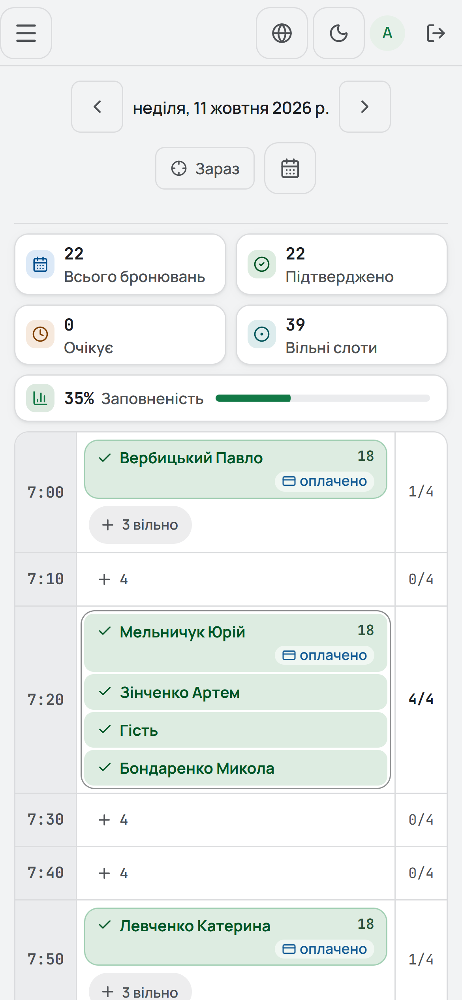

### Payments

Card payments go through [WayForPay](https://wayforpay.com), using the club's
own merchant account. A booking is held as "awaiting payment" while the golfer
is at checkout and released if they don't pay in time.

The payment flow covers the hard cases: 3-D Secure steps that stall, declines
followed by a late approval, abandoned tabs, and refunds. A background
reconciler checks every open payment against the provider, and a daily audit
compares Parity's records with the provider's statement.

## How it works

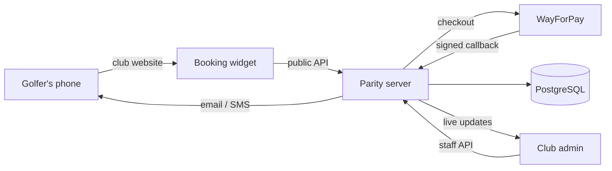

- **One server, two front ends.** The widget talks to a public, rate-limited
  API scoped to one club. The admin talks to an authenticated API with
  role-based access.
- **Multi-club by design.** Every record belongs to a club, and the server
  enforces it on every request.
- **No double bookings.** Capacity check and insert happen in one database
  transaction.
- **Live tee sheet.** Changes reach every open admin screen within a second
  over Server-Sent Events.
- **Audit trail.** Every change to a booking (by staff, the golfer or the
  payment system) is recorded with who did it and when.
- **Time zones.** Times are stored in UTC and shown in the club's local time.

## Tech stack

| Layer | Tools |
|---|---|
| Language | TypeScript (strict), npm workspaces monorepo |
| Server | Node.js, Express, Prisma, PostgreSQL, Zod |
| Admin | React 19, React Router, Vite, CSS Modules, Recharts, dnd-kit, i18next |
| Widget | React 19 bundled into a single script file, no external CSS |
| Auth | Short-lived access tokens, rotating refresh tokens with reuse detection |
| Integrations | WayForPay (payments), Resend (email), TurboSMS (SMS/Viber) |
| Testing | Vitest, including HTTP-level route tests |

## Design

The widget and the admin each have their own design system.

- **Widget:** light, quiet and precise. One brand colour (racing green), Geist
  type, no exclamation points or urgency tricks. Built to WCAG 2.1 AA, with
  44px touch targets and 16px+ body text for readability outdoors.
- **Admin:** dense but calm. Strictly neutral greys, colour used only for
  meaning (booking status), and a full dark theme for evening shifts.
- **Ukrainian Cyrillic is a hard requirement.** Every typeface must render
  `і ї є ґ` properly in every weight it is used in.

## Status

Parity runs in production every day. Development is ongoing, with new
modules and improvements shipped regularly.
